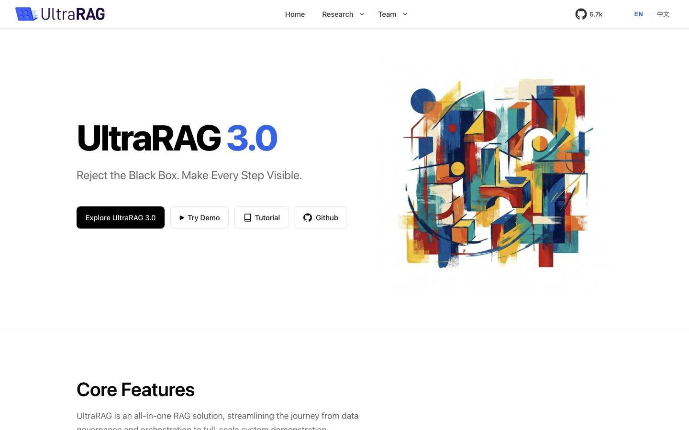
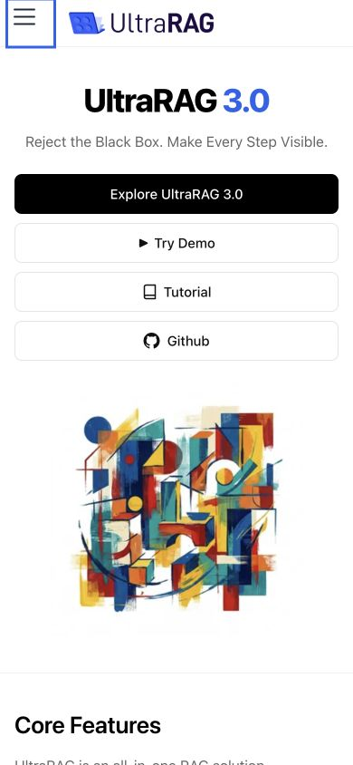

# Website quality audit — November 10, 2026

The audit covers the homepage, desktop/mobile navigation, research, team, contact, release articles, the interactive demo, and the daily paper feed. It preserves the existing white/blue branding and artwork.

## Findings and changes

| Area | Observed problem | Change |
| --- | --- | --- |
| Media | Oversized logo, hero and screenshots; missing intrinsic dimensions and hero priority | Generate responsive WebP variants, reserve aspect ratios, prioritize the hero, and lazy-load secondary images |
| Responsive layout | Large mobile artwork pushed every CTA below the fold; carousel arrows overflowed tablet/narrow desktop layouts; negative hero margin could cover buttons | Put mobile text/actions first, constrain the artwork, wrap CTAs, and keep arrows within the viewport |
| Navigation | The mobile sidebar header (including its close button) was hidden; desktop dropdowns depended on hover | Restore and layer the drawer header; add disclosure buttons, Arrow Down, Escape, focus/outside dismissal, and expanded states |
| Carousel | Automatic rotation continued offscreen and during keyboard interaction; dots were mouse-only | Default to manual navigation, provide an explicit slideshow control and labeled buttons, and pause rotation for focus, hover, hidden pages, offscreen content and reduced motion |
| Accessibility | Low-contrast secondary text, skipped heading levels, unnamed demo controls and incorrect document language | Improve contrast/semantics, add names/focus indicators, synchronize the HTML language with the selected language, and support reduced motion |
| Quick start | Missing clone/build steps, obsolete `examples/sayhello.yaml` and unsupported `--admin` | Show the current `uv run` local-mode build/run/UI commands in both languages; restore code copying |
| Demo lifecycle | An uncancelled thinking timeout could start a response after a session switch; copying dereferenced a React event asynchronously | Own and cancel both streaming phases, clean up on unmount, and give the copy control its own feedback/timer lifecycle |
| Demo UX | Mobile drawer started open, desktop sidebar expanded after hydration, and initial automatic scrolling hid the introduction | Reserve the desktop sidebar during SSR, initially hide the mobile drawer, trap/restore mobile focus, show the start of the sample conversation, and respect readers who scroll up |
| Demo clarity | The preview could be mistaken for live model inference | Keep a visible bilingual notice that replies are pre-recorded; label inputs/send actions and guard IME composition; make sample Markdown web links usable |
| Daily papers | The current feed produced about 16,878 DOM nodes; failures/empty feeds could strand the page | Initially render seven populated dates (about 1,477 nodes in the observed feed), load earlier dates on demand, keep full timeline navigation, cancel/timeout requests, and offer retry/source fallback; validate external link schemes |
| Metadata/content | Missing social-card image and an author avatar referenced a nonexistent PNG; public template page remained | Use existing artwork for sharing metadata, correct the avatar extension and remove the template page |
| Validation | No PR checks or repeatable audits | Add regression tests, strict build/link/anchor validation, a compressed production preview and pinned Lighthouse scripts; upload reports in PR CI |

## Lighthouse measurements

Lighthouse **13.0.3**, Chrome **157**, macOS, fresh headless Chrome profiles. Mobile uses Lighthouse's default simulated mobile network and 4× CPU slowdown; desktop uses its desktop preset. Google Analytics and the GitHub counter remain enabled. Runs were sequential.

The comparison below serves the untouched `main` revision `4a11df3` and the optimized production build through the same local gzip preview with a 600-second cache lifetime. These are lab measurements, not field Core Web Vitals or a claim about an already deployed release.

| Homepage | Performance | Accessibility | Best practices | SEO |
| --- | ---: | ---: | ---: | ---: |
| Baseline, mobile | 94 | 96 | 96 | 92 |
| Optimized, mobile (repeat runs) | 97–98 | 100 | 96 | 100 |
| Baseline, desktop | 100 | 96 | 96 | 92 |
| Optimized, desktop | 100 | 100 | 96 | 100 |

Mobile LCP changed from **3.10 s** to **2.34–2.57 s** in these runs. Measured homepage requests fell from approximately **1,053 KiB to 489 KiB** during the audit, including carousel activity. The optimized homepage and demo recorded **CLS 0**. The optimized demo scored **98 / 100 / 96 / 100** on mobile and **100 / 100 / 96 / 100** on desktop.

The initial live-site snapshot scored **52 / 96 / 96 / 92** on mobile and **88 / 96 / 96 / 92** on desktop. Its different origin/network conditions make it unsuitable as the numerical baseline for localhost improvements.

The remaining best-practices deduction is a failed Google Analytics collection request in this network environment. Analytics was retained and was not blocked to improve the score. GitHub Pages' cache lifetime is controlled by the host; this PR does not claim to change its response headers. Some framework-wide CSS/JavaScript remains unused on individual routes. Paper freshness depends on the upstream feed, which currently includes many recent empty dates; the website skips empty groups. Re-run the public URL after deployment to assess CDN latency and external services.

## Validation and reproduction

- Five regression tests cover cancellation during thinking/streaming, final response metadata, and safe external URLs.
- Production compilation checks broken links/anchors; the additional checker verifies links, media and metadata across all 16 generated HTML pages.
- Browser QA covers 320, 390, 768, 1024 and 1440 CSS pixel widths, English/Chinese switching, navigation disclosures/close, keyboard focus, carousel controls, code copying, new chats, session switching, and paper pagination/timeline navigation.
- Article videos use `preload="none"`; the first release video was played and paused successfully, and the original media files remain available.
- `npm run check` runs tests, build and local asset checks. `npm run audit:lighthouse -- <url> <output-directory>` saves both profiles' HTML/JSON reports. Missing metrics and audit errors are not reported as zero scores.

See the repository README for setup and commands. The PR workflow uploads the raw homepage Lighthouse reports; local audit reports are kept outside the tracked source tree. Creating this PR does not deploy the branch or merge it into `main`.

## Preview

